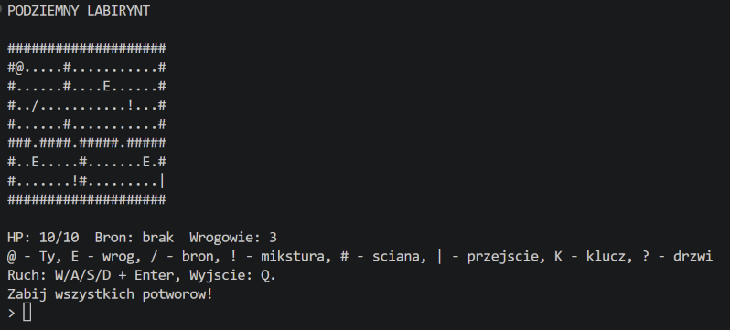

# Underground Labyrinth (Podziemny Labirynt)

A small turn-based dungeon crawler that runs in the terminal. You move a hero around a text map, fight monsters, pick up items and clear two levels.

Written in Python 3 with the standard library only. It was my project for an object-oriented programming course, so the main goal was a clean class design rather than game complexity.



## Running it

Requires Python 3.8 or newer. No packages to install.

```
python main.py
```

On Linux/macOS use `python3 main.py`.

## Controls

| Key | Action |
|---|---|
| `W` `A` `S` `D` + Enter | move (moving into a monster attacks it) |
| `Q` + Enter | quit |

## How to play

- **Level 1:** kill all monsters, then walk to the passage `|` in the bottom right corner. It will not let you through while any monster is alive.
- **Level 2:** pick up the key `K`, open the door `?`, and kill all monsters to win.
- You start with 10 HP. A sword (`/`) adds damage, a potion (`!`) heals. Monsters chase you when you are within 6 tiles.
- HP and equipment carry over to level 2.

## Code structure

```
NonCopyable
├── Actor (abstract)
│   ├── Hero
│   └── Enemy
├── Item (abstract)
│   ├── Weapon
│   ├── Potion
│   └── Key
├── Map
├── InputHandler
├── Renderer
└── Engine
```

- `Engine` runs the game loop and turns; it does not read keys or draw anything itself.
- `InputHandler` turns typed text into `Command` values. Key bindings live in a dictionary passed to the constructor, so changing controls does not touch the class.
- `Map` knows walls, doors and the items lying on the floor. `Renderer` only draws.
- `Actor` and `Item` are abstract: each subclass defines its own `attack_power()` / `on_pickup()`, and the engine calls them without knowing the concrete type.
- Fields are private or protected, exposed through read-only properties.
- All objects block copying (`__copy__` / `__deepcopy__` raise `TypeError`) through the shared `NonCopyable` base class.

Full documentation with module descriptions and a UML diagram (in Polish): [docs/Documentation_PL.pdf](docs/Documentation_PL.pdf)

## Notes

- Game text is in Polish and written without diacritics so it displays the same in any terminal.
- Levels are plain lists of strings at the top of `engine.py`, so adding a level means adding another layout.

## License

MIT, see [LICENSE](LICENSE).
